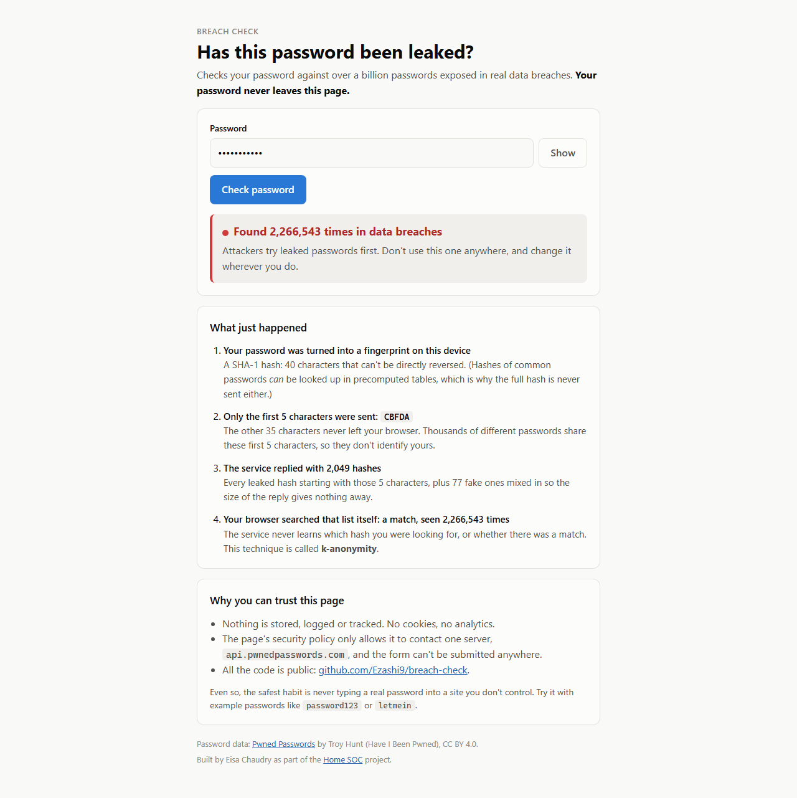

# Breach Check

[](https://github.com/Ezashi9/breach-check/actions/workflows/ci.yml)

**Try it: https://ezashi9.github.io/breach-check/**

Checks whether a password has appeared in a real data breach, using the [Pwned Passwords](https://haveibeenpwned.com/Passwords) database from Have I Been Pwned (over a billion leaked passwords), **without ever sending the password anywhere**.

Two versions share the same design: a web page, where the hashing happens in your browser, and a Python command-line tool.



## How it keeps the password private: k-anonymity

1. The password is turned into a **SHA-1 hash** (a 40-character fingerprint) on your own device.
2. Only the **first 5 characters** of the hash are sent, e.g. `GET /range/CBFDA`.
3. The service replies with **every** leaked hash starting with those 5 characters, about 2,000 of them.
4. Your device searches that list itself. The service never learns which hash you were looking for, or whether there was a match.

Thousands of leaked passwords share any 5-character prefix, so the prefix doesn't identify yours. That's what **k-anonymity** means: your request is indistinguishable from at least *k* others.

**Padding.** Even the *size* of a reply could hint at which prefix was requested. Both versions send the `Add-Padding: true` header, so the service mixes in fake entries with a count of 0. The tool counts and ignores them. A test checks that a decoy matching your hash is never reported as a breach.

Why not send the full hash? Hashes of common passwords can be looked up in precomputed tables, so a full SHA-1 of `password123` is as good as the password itself.

## Results

| Password | Times seen in breaches |
|---|---|
| `admin` | 42,266,086 |
| `qwerty` | 30,812,897 |
| `password123` | 2,266,543 |
| `letmein` | 1,406,604 |
| `Correct-Horse-Battery-Staple-9x!Kq` | 0 |

Attackers start with exactly these lists. When Log Hunter analysed real SSH attacks, the most-targeted accounts were `root` and `admin`, and passwords like these are what get tried against them.

## Security design of the web page

| Protection | Why |
|---|---|
| Hashing done in the browser (Web Crypto API) | The password never leaves the page. |
| Content Security Policy: `connect-src https://api.pwnedpasswords.com` | The page is only *allowed* to talk to one server. Even a bug or a malicious script couldn't send the password elsewhere. |
| `form-action 'none'` | The form can't be submitted anywhere, so the password can't end up in a URL or browser history. |
| No storage, cookies, analytics or logging | Nothing about what you typed survives the page. A test checks the code never uses `localStorage`, cookies or `console.log`. |
| `referrerPolicy: no-referrer`, `cache: no-store` | The request carries no information about where it came from and isn't cached. |
| API errors shown as errors | If the service is unreachable the page says so. It never reports "not found", which would falsely reassure you. |

**Verified in a real browser.** I ran checks through the page in headless Chrome and recorded every network request. The only outside requests were to `api.pwnedpasswords.com/range/<5 characters>` (plus the browser's standard permission check), the password appeared in none of them, and the page address never changed.

**The Python tool** never accepts a password as a command-line argument, because those are saved in shell history and visible to other users through the process list. It asks with a hidden prompt instead.

## Usage

**Web:** open https://ezashi9.github.io/breach-check/, or serve `docs/` locally (`cd docs && python -m http.server`) and open `http://localhost:8000`.

**Python 3.10+** (nothing to install):

```bash
python -m breach_check                       # hidden prompt for one password
python -m breach_check --file passwords.txt  # check a list (masked output; add --show to reveal)
```

`--file` is designed for the next part of Home SOC: checking the passwords attackers try against a honeypot.

## Tests

```bash
python -m unittest discover -s tests -t .   # Python: 7 tests
node --test tests/hibp.test.mjs              # JavaScript: 7 tests
```

Both suites check that only the 5-character prefix is sent, that padding decoys are ignored, and that results are correct. The JavaScript suite also checks that the browser's hashing matches Python's and enforces the page's security rules.

## Project layout

```
breach_check/   Python tool (hibp.py = k-anonymity lookup, __main__.py = command line)
docs/           web version, served by GitHub Pages
  hibp.js       hashing + lookup (shared logic, unit tested)
  app.js        page behaviour (textContent only)
  index.html    page + Content Security Policy
tests/          Python and JavaScript tests
```

## Credits

Password data: [Pwned Passwords](https://haveibeenpwned.com/Passwords) by Troy Hunt, licensed CC BY 4.0. Part of my [Home SOC](https://github.com/Ezashi9/home-soc-dashboard) project.
